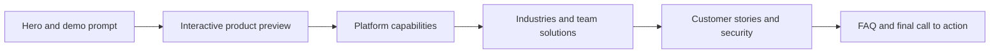
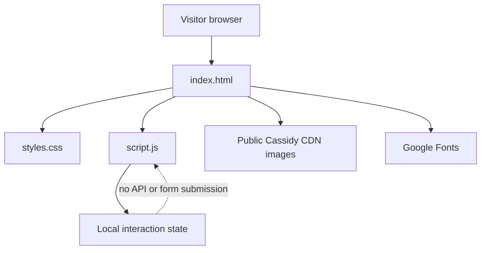

<div align="center">

# Cassidy AI Homepage Recreation

### A responsive, no-build front-end recreation of an enterprise AI product homepage.

[](https://github.com/Skeeb32/cassidy-ai-homepage-recreation/stargazers)
[](https://github.com/Skeeb32/cassidy-ai-homepage-recreation/forks)
[](https://github.com/Skeeb32/cassidy-ai-homepage-recreation/issues)
[](https://github.com/Skeeb32/cassidy-ai-homepage-recreation/commits/main)


[View the source repository](https://github.com/Skeeb32/cassidy-ai-homepage-recreation) · [Visit the Cassidy reference site](https://www.cassidyai.com/)

</div>

---

## The project

This repository recreates the visual structure and front-end interactions of the Cassidy AI homepage as a lightweight static site. It takes visitors through the product story—from the hero and interactive product preview to platform capabilities, industry examples, customer stories, enterprise security, and FAQs.

The page is built with plain HTML, CSS, and JavaScript. There is no package installation, bundler, framework, or server-side application to configure.

> **Preview:** A private deployed preview is available to the site owner at [cassidy-ai-homepage.shaqib-dev.chatgpt.site](https://cassidy-ai-homepage.shaqib-dev.chatgpt.site). Public access is not configured.

## Visual showcase

The product preview is a front-end mockup. Its four tabs change the workspace title and supporting copy; they do not connect to a live Cassidy account or backend.


*Workflow illustration served by Cassidy's public website CDN. It is not a screenshot of this repository's runtime.*

### Page flow



## Features

| Area | What it includes |
| --- | --- |
| Product preview | Four selectable views for workflows, agents, knowledge, and meetings |
| Navigation | Sticky header with an accessible mobile menu |
| Solutions | Scrollable team solution cards with previous and next controls |
| FAQ | Native expandable disclosures using `<details>` and `<summary>` |
| Forms | Email validation and a local preview message; no visitor data is submitted |
| Responsive layout | Layouts for desktop, tablet, and narrow screens, with reduced-motion support |
| Content sections | Platform layers, industries, customer examples, model choices, and enterprise controls |

## Technology and architecture

- **HTML:** semantic page structure, native email inputs, and FAQ disclosures
- **CSS:** responsive layouts, design tokens, component styling, and reduced-motion rules
- **JavaScript:** menu state, product preview tabs, carousel controls, and demo form preview behavior
- **External assets:** product and customer imagery from Cassidy's public Webflow CDN; DM Sans from Google Fonts
- **Runtime:** static files served directly by a browser or static host



The interaction code updates the page locally. The demo form is intentionally presentational: it validates an email address, displays a setup note, and does not send or store the address.

## Quick start

### Requirements

- A modern browser
- Python 3 for the optional local web server

There are no npm dependencies and no environment variables.

### Run locally

```bash
git clone https://github.com/Skeeb32/cassidy-ai-homepage-recreation.git
cd cassidy-ai-homepage-recreation
python3 -m http.server 8000
```

Open [http://localhost:8000](http://localhost:8000). You can also open `index.html` directly in a browser; using the local server more closely matches static hosting.

### Build and deploy

There is no build step. The source files are at the repository root. The repository currently has no GitHub Pages workflow or public deployment configured. To host it, point a static host at the root directory and publish `index.html`, `styles.css`, and `script.js` together.

## Testing and quality

No automated test suite or lint configuration is included. For a manual review, open the page at desktop and mobile widths and check the navigation, product tabs, solution carousel, FAQ disclosures, and email form preview.

The markup includes input labels, button names, tab selection state, and native keyboard-operable controls. Responsive styles include a reduced-motion preference. These are implementation details; no third-party accessibility audit has been run.

## Repository map

```text
.
├── index.html          # Homepage content and page structure
├── styles.css          # Visual system and responsive layouts
├── script.js           # Small client-side interactions
└── README.md           # Project overview and setup guide
```

## Roadmap

This repository currently contains a single static homepage. Useful next steps, if the project is continued:

- Capture and commit screenshots of this implementation at desktop and mobile sizes.
- Connect the demo request form to a chosen form service or API.
- Add automated checks for link targets, responsive behavior, and keyboard interaction.
- Configure a public static deployment if a public demo is desired.

These are suggestions for future work; none is currently represented as an active milestone.

## Contributing

Small improvements to responsiveness, semantics, keyboard use, and documentation are welcome. Open an issue first for larger changes so the scope can be discussed.

1. Fork the repository and create a focused branch.
2. Keep the page dependency-free unless a change clearly requires a dependency.
3. Check the page at both narrow and wide widths and exercise the interactive controls.
4. Open a pull request with a short description and before/after screenshots for visual changes.

No license has been added to this repository. The Cassidy name, product copy, and externally hosted brand/product imagery belong to their respective owners; this repository does not grant rights to reuse those materials. This project is not affiliated with or endorsed by Cassidy.

## For engineers and recruiters

This is a small front-end project that demonstrates how to build a long-form marketing experience without a framework: semantic document structure, a responsive CSS system, accessible interaction state, progressive use of native browser controls, and straightforward static deployment. The deliberate trade-off is a mock product preview and demo form rather than a connected application.

## Join in

If this recreation is useful as a front-end reference, ⭐ star the repository or fork it to experiment. Found an issue? [Open a GitHub issue](https://github.com/Skeeb32/cassidy-ai-homepage-recreation/issues).

<div align="center">

**Explore the code · Try the page · Share an improvement**

</div>
